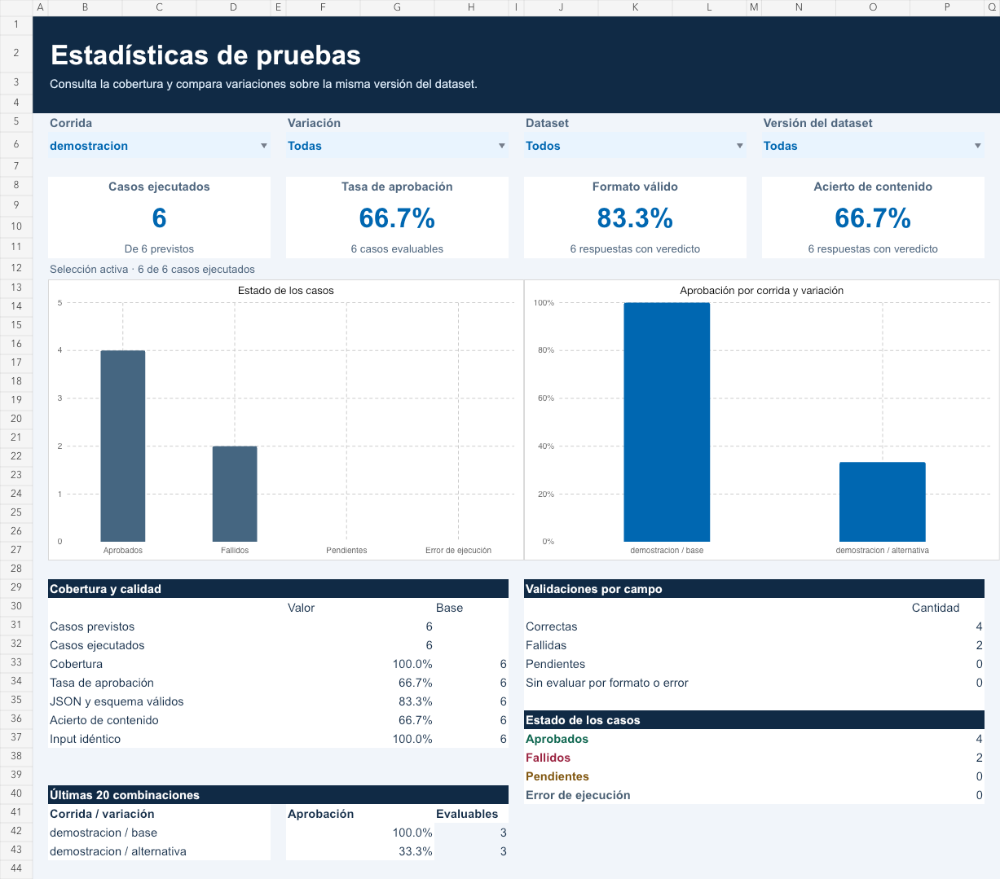

# Probar prompts

Skill de Codex para evaluar prompts de clasificación y extracción contra una batería con claves. Compara el input de referencia con el enviado, valida la respuesta JSON y genera un reporte Excel por caso, por campo y por corrida.



## Usar la skill

```bash
git clone https://github.com/williamvp10/probar-prompts.git ~/.codex/skills/probar-prompts
cd ~/.codex/skills/probar-prompts
npm ci --prefix scripts
```

Si usas otra raíz de Codex, clona dentro de su carpeta `skills`. La ejecución requiere Node.js 20 o posterior y `@oai/artifact-tool` para Excel. Si el runtime de hojas de cálculo de Codex no se detecta automáticamente, usa `load_workspace_dependencies` y asigna `PROMPT_EVAL_ARTIFACT_TOOL` al directorio `node_modules` que devuelve la herramienta.

Invócala como **`$probar-prompts`**. Por ejemplo, «Usa `$probar-prompts` para evaluar estos correos y transcripciones con el agente actual. Guarda las respuestas y genera el reporte».

El agente actual es el modo predeterminado. La modalidad API requiere una elección explícita y usa `PROMPT_EVAL_API_KEY`. [Modo API](references/api.md)

## Qué entra y qué sale

- **Entrada.** Un Excel con las hojas Dataset, Prompts y Validaciones, o un JSON con el mismo contenido. Incluye entradas literales, versiones, esquemas y claves. [Plantilla de entrada](assets/plantilla-entrada.xlsx) · [Entrada ficticia](assets/entrada-ejemplo.json)
- **Salida.** Un expediente por variación con los trabajos, las respuestas y los dictámenes, más un Excel consolidado con estadísticas y detalle. [Plantilla de resultados](assets/plantilla-resultados.xlsx) · [Reporte ficticio](assets/reporte-ejemplo.xlsx)

[Ver ejemplos y reproducir el reporte](references/ejemplos.md) · [Leer el contrato de datos](references/contrato.md)

## Estructura de la skill

| Ruta | Función |
| --- | --- |
| [`SKILL.md`](SKILL.md) | Nombre, alcance y flujo que lee Codex. |
| [`agents/openai.yaml`](agents/openai.yaml) | Nombre y texto de inicio en la interfaz. |
| [`scripts/`](scripts/) | Preparación, validación, conector API y generación del Excel. |
| [`references/`](references/) | Contrato, casos trabajados y configuración API. |
| [`assets/`](assets/) | Plantillas y demostración con datos ficticios. |

La versión de la skill se publica mediante etiquetas de Git. Las versiones de los prompts y del dataset se declaran en los archivos de entrada. Cada corrida conserva los hashes del prompt, su esquema y la batería.
